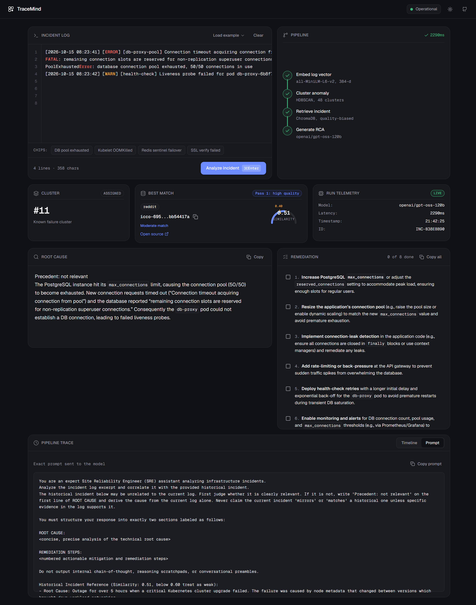

# TraceMind — RAG-Powered Root Cause Analysis for SRE Logs

An automated NLP pipeline that clusters log anomalies and uses Retrieval-Augmented Generation (RAG) to match incoming infrastructure failures against historical incident postmortems. TraceMind synthesizes root cause analyses and prioritized remediation checklists with full pipeline transparency, enabling Site Reliability Engineers (SREs) to audit the reasoning rather than trusting a black box.

---

## Status

**Backend verified on Hugging Face Spaces (`https://nishhhx0-tracemind-backend.hf.space`), frontend pending Vercel deploy.**

- **ML Inference & Vector Retrieval:** Active on Hugging Face Spaces via FastAPI mounted on Gradio.
- **LLM Provider:** `openai/gpt-oss-120b` via Groq Cloud API with client-side rate limiting and automatic caching.
- **Frontend Dashboard:** Dark/light Bento console built with Next.js 16, Tailwind CSS v4, and shadcn/ui.
- **Verification Status:** 30/30 unit and integration tests passing (`python -m pytest`).

---

## Architecture

```
Raw Server Log Input
         │
         ▼
Embedding Layer (sentence-transformers / all-MiniLM-L6-v2, 384-d)
         │
         ▼
Anomaly Clustering (HDBSCAN)  ──►  Groups/deduplicates incoming log chunks (48 clusters)
         │                         Acts as preprocessing / dedup step before vector search
         ▼
2-Pass Vector Retrieval (ChromaDB)
  ├── Pass 1: Filter quality:high postmortems (0.40 cosine similarity floor)
  └── Pass 2: Fallback across full postmortem corpus if Pass 1 misses
         │
         ▼
RAG-Augmented Prompt Construction (relevance_gate_v2)
  └── Enforces strict precedent relevance gating ("Precedent: relevant | not relevant")
         │
         ▼
LLM Generation (openai/gpt-oss-120b via Groq Cloud API)
         │
         ▼
Structured RCA Output
  ├── Precedent Relevance Badge ("Precedent applied" vs. "No relevant precedent")
  ├── Root Cause Synthesis (Markdown)
  ├── 5-Step Actionable Remediation Checklist
  └── Pipeline Trace (Telemetry, Cosine Similarity Gauge, Cluster ID, Raw Prompt)
```

---

## Tech Stack

| Component | Technology | Role / Specification |
|---|---|---|
| **Embeddings** | `sentence-transformers` | `all-MiniLM-L6-v2` (384-dimensional normalized dense vectors) |
| **Clustering** | `HDBSCAN` | 48 clusters on train corpus (`min_cluster_size=3`, `min_samples=2`), 71.4% of noise is high-quality |
| **Vector Store** | `ChromaDB` | Persistent vector index with 2-pass quality-biased retrieval and 0.40 cosine floor |
| **LLM Generation** | Groq Cloud API | `openai/gpt-oss-120b` (prompted inference, zero fine-tuning, `relevance_gate_v2`) |
| **Backend API** | `FastAPI` / `Uvicorn` | REST API (`/analyze`, `/health`) with per-IP rate limiting and proxy routing |
| **Frontend UI** | `Next.js 16` (Turbopack) | Dark/light Bento dashboard, Tailwind CSS v4, shadcn/ui, `react-markdown` |
| **Evaluation** | Python / Pytest | ROUGE (1, 2, L), Embedding Cosine Similarity, Retrieval Category Hit Rate, Actionability Rubric |

---

## Dataset & Zero-Leakage Guarantee

The postmortem corpus contains **828 curated incident reports** standardized into a unified schema, sourced aggregator-first across:

- **`icco/postmortems`**: Curated tech industry postmortem collection.
- **Statuspage.io incident histories**: Structured scrape across 20 SaaS and infrastructure providers (Datadog, Reddit, Discord, Twilio, Sentry, CircleCI, DigitalOcean, GitHub, Dropbox, Squarespace, and others).
- **Google Cloud Platform (GCP)**: Official incident retrospectives and outage disclosures.
- **Cloudflare Blog**: Detailed technical postmortems.

### Postmortem Schema

```json
{
  "incident_id": "string",
  "company": "string",
  "raw_log_excerpt": "string",
  "root_cause": "string",
  "remediation_steps": "string",
  "source_url": "string",
  "quality": "high | low"
}
```

*Corpus Quality Breakdown:* **544 High Quality** / **284 Low Quality** (828 total).

### Company-Grouped Split (Zero Data Leakage)

To eliminate data leakage and validate real-world out-of-distribution generalization, the corpus is split **strictly by company** using fixed seed 42 (`scripts/make_split.py`):

- **Train Split (`data/train.json`):** 662 incidents across 18 companies. Forms the exclusive corpus for HDBSCAN clustering centroids and the ChromaDB retrieval index (`rag/chroma_db`).
- **Held-Out Test Split (`data/test.json`):** 93 incidents across 40 companies. **100% of test records are strictly `quality: high`**.
- **Excluded Contamination Filter:** 73 low-quality incidents from the 40 test companies are excluded from both splits to prevent quality and company leakage.
- **Zero Company Overlap:** No company in the test set exists in the training set (`set(train_companies) & set(test_companies) == set()`).
- **Maximum Cross-Split Similarity:** **0.8438** between test and train `root_cause` embeddings (strictly below the 0.95 near-duplicate threshold).

---

## Retrieval & Pipeline Trace

TraceMind is designed for auditability. Rather than producing opaque predictions, the console surfaces an interactive **Pipeline Trace**:

- **Matched Historical Precedent:** The nearest past incident with title, company, and direct hyperlink to the official public postmortem.
- **Similarity Gauge:** Semicircular SVG gauge displaying the cosine similarity score with an explicit **0.40 threshold marker** (scores ≥ 0.60 labeled *Strong match*, 0.40–0.59 labeled *Moderate match*, < 0.40 labeled *Weak match, treat as hypothesis*).
- **Relevance Gate Badge:** Real-time badge indicating whether the historical match was applied (`Precedent applied`) or rejected as irrelevant (`No relevant precedent`).
- **Raw Prompt Inspection:** Tabbed view displaying the exact system prompt, user prompt, and model parameters delivered to the LLM.



---

## Quantitative Evaluation & Benchmark Results

Evaluation is executed on the held-out **93-record test set** (`data/test.json`) using `eval/evaluate.py`. All evaluations use real inference via `openai/gpt-oss-120b` (mock completions cause hard assertion failures).

### 1. RAG vs. Zero-Shot Ablation ($N = 93$)

Direct comparison of TraceMind (RAG with ChromaDB retrieval) against an unaugmented Zero-Shot baseline:

| Metric | Zero-Shot (No RAG) | RAG (TraceMind) | Delta |
|---|---|---|---|
| **ROUGE-1 F1** | 0.1809 | **0.1941** | **+0.0132** |
| **ROUGE-2 F1** | 0.0384 | **0.0439** | **+0.0055** |
| **ROUGE-L F1** | 0.1061 | **0.1210** | **+0.0149** |
| **Semantic Similarity** | 0.5743 | **0.5764** | **+0.0021** |

### 2. Retrieval Quality & Similarity Distribution ($N = 93$)

Measured against the 662 training postmortems in ChromaDB (`scripts/verify_no_leakage.py`):

| Retrieval Statistic | Value | Notes |
|---|---|---|
| **Mean Top-1 Similarity** | **0.5273** | Consistent correlation across heterogeneous infra logs |
| **Median Top-1 Similarity** | **0.5333** | Robust central tendency |
| **Similarity Range** | 0.2406 – 0.8424 | Verified minimum and maximum bounds |
| **Incidents Below 0.40 Floor** | **7 / 93 (7.53%)** | Routed to Pass 2 fallback / marked as weak precedent |
| **Self-Retrieval Leakage** | **0 / 93 (0.0%)** | Programmatically verified zero identity leakage |
| **Same-Company Leakage** | **0 / 93 (0.0%)** | Zero company overlap across splits |

### 3. Relevance Gate Audit ($N = 7$)

To prevent RAG hallucination when retrieval similarity is weak, the `relevance_gate_v2` prompt instructs the model to inspect the correlation and output `Precedent: not relevant` on line 1 if the retrieved postmortem does not match the failure mode:

- **Test Sample:** The 7 test postmortems below the 0.40 similarity floor (Boeing 0.359, Discord 0.389, EVE Online 0.378, LKML 0.398, Medium 0.357, Therac-25 0.241, Zerodha 0.366).
- **Result:** **7 / 7 (100.0%)** correctly identified `Precedent: not relevant` and synthesized root causes derived solely from the log excerpt without hallucinating false historical analogies.

### 4. Retrieval Category Hit Rate ($N = 93$)

Evaluated using `eval/category_benchmark.py` across 9 infrastructure failure modes:

| Failure Category | Test Incidents | Category Hit Rate |
|---|---|---|
| **Software Bug / Logic Error** | 33 | 54.5% (18/33) |
| **Storage / Database / Disk** | 18 | 16.7% (3/18) |
| **Configuration / Bad Deployment** | 13 | 15.4% (2/13) |
| **Capacity / Traffic Spike** | 12 | 25.0% (3/12) |
| **Security / Auth / Credentials** | 6 | 50.0% (3/6) |
| **Network / Connectivity** | 5 | 40.0% (2/5) |
| **Hardware / Infrastructure** | 3 | 0.0% (0/3) |
| **Third-Party / Dependency Outage** | 2 | 0.0% (0/2) |
| **Memory / OOM / Resource Leak** | 1 | 0.0% (0/1) |
| **Overall Top-1 Category Hit Rate** | **93** | **33.33% (31/93)** |

### 5. Actionability Rubric (1–5 Scale)

Remediation steps are evaluated against the SRE Actionability Rubric (`eval/actionability_rubric.md`):
- **Score 1:** Harmful / Hallucinatory
- **Score 2:** Generic / Boilerplate (*"Restart the server and monitor logs"*)
- **Score 3:** Directionally Correct (identifies component but lacks parameters)
- **Score 4:** Specific & Actionable (concrete flags, commands, rollback steps)
- **Score 5:** Production-Ready & Mitigative (immediate mitigation + rollback + long-term alert threshold)

---

## Security & Production Hardening

- **Locked CORS Configuration:** Cross-Origin Resource Sharing is strictly constrained to `http://localhost:3000`, `http://localhost:3001`, and the designated production domain (`https://tracemind.vercel.app`). Wildcard matching (`*.vercel.app`) is disabled to prevent unauthorized API key consumption.
- **Client IP Rate Limiting:** In-memory sliding window rate limiter enforcing a strict maximum of **15 analysis requests per minute per IP** (`IP_RATE_LIMIT_RPM`). Requests exceeding this limit receive `HTTP 429 Too Many Requests`.
- **Pre-Warmed Generation Cache:** All frontend example presets are pre-warmed in SQLite (`scripts/prewarm_cache.py`). Preset clicks return cached completions instantaneously without consuming Groq API tokens or triggering 429/502 errors.
- **Explicit API Base Path:** The frontend uses `NEXT_PUBLIC_API_URL` and `NEXT_PUBLIC_API_BASE_PATH` explicitly, decoupling API routing from URL string heuristics.

---

## Setup & Local Development

### Prerequisites
- Python 3.11+
- Node.js 20+ and npm
- A Groq Cloud API Key ([console.groq.com](https://console.groq.com))

### 1. Environment Configuration

Create a `.env` file in the repository root:

```bash
# LLM Provider Configuration
GROQ_API_KEY="gsk_your_actual_key_here"
LLM_MODEL="openai/gpt-oss-120b"
LLM_MAX_RPM=20

# Backend Security & Networking
IP_RATE_LIMIT_RPM=15
ALLOWED_ORIGINS="http://localhost:3000,https://tracemind.vercel.app"

# Frontend API Target
NEXT_PUBLIC_API_URL="http://127.0.0.1:8000"
NEXT_PUBLIC_API_BASE_PATH=""
```

> **Security Note:** Never commit `.env` or expose API keys. The `.gitignore` file enforces exclusion of all environment files.

### 2. Backend Setup & Ingestion

```bash
# Install Python dependencies
pip install -r requirements.txt

# Ingest the 662 training postmortems into ChromaDB
python rag/generate.py --force

# Pre-warm SQLite generation cache for frontend presets
python scripts/prewarm_cache.py

# Verify zero data leakage against held-out test split
python scripts/verify_no_leakage.py

# Start FastAPI backend (http://127.0.0.1:8000)
python -m uvicorn backend.main:app --host 127.0.0.1 --port 8000 --reload
```

### 3. Frontend Setup

```bash
cd frontend

# Install Node dependencies
npm install

# Run Next.js in development mode (http://localhost:3000)
npm run dev

# Or build for production
npm run build
npm run start
```

### 4. Running the Test Suite & Evaluation

```bash
# Run backend, clustering, and split verification tests (30 tests)
python -m pytest

# Run full RAG vs. Zero-Shot evaluation on 93 test incidents
python eval/evaluate.py

# Run failure category retrieval benchmark
python eval/category_benchmark.py
```

---

## License

This project is licensed under the [MIT License](LICENSE).
