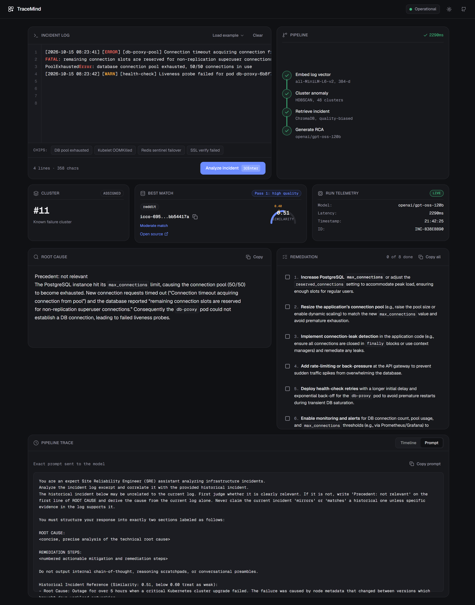

# TraceMind — RAG-Powered Root Cause Analysis for SRE Logs

An automated NLP pipeline that clusters log anomalies and correlates incoming infrastructure failures against a curated corpus of 828 historical incident postmortems. TraceMind surfaces an interactive Pipeline Trace—exposing matched historical incident URLs, cosine similarity scores, and prompts—so SREs can audit retrieval evidence rather than trusting an opaque model. In controlled 2x2 factorial evaluation (N=93), prompt conciseness and instruction formatting drive the observed score gains (+0.0727 to +0.0851 ROUGE-L F1), while precedent retrieval contributes a modest effect (+0.0143 in baseline format, +0.0019 in gate-v2 format; non-significant under company-clustered bootstrap).

---

## Status

**Backend verified on Hugging Face Spaces (`https://nishhhx0-tracemind-backend.hf.space`), frontend pending Vercel deploy.**

- **ML Inference & Vector Retrieval:** Active on Hugging Face Spaces via FastAPI mounted on Gradio.
- **LLM Provider:** `openai/gpt-oss-120b` via Groq Cloud API with client-side rate limiting and automatic caching.
- **Frontend Dashboard:** Dark/light Bento console built with Next.js 16, Tailwind CSS v4, and shadcn/ui.
- **Verification Status:** 30/30 unit and integration tests passing (`python -m pytest`).

---

## Architecture

```
Raw Server Log Input
         │
         ▼
Embedding Layer (sentence-transformers / all-MiniLM-L6-v2, 384-d)
         │
         ▼
Anomaly Clustering (HDBSCAN)  ──►  Groups similar incident reports; the group label is shown in the Pipeline Trace and does not change retrieval (39 clusters)
         │
         ▼
2-Pass Vector Retrieval (ChromaDB)
  ├── Pass 1: Filter quality:high postmortems (0.40 cosine similarity floor)
  └── Pass 2: Fallback across full postmortem corpus if Pass 1 misses
         │
         ▼
RAG-Augmented Prompt Construction (relevance_gate_v2)
  └── Enforces strict precedent relevance gating ("Precedent: relevant | not relevant")
         │
         ▼
LLM Generation (openai/gpt-oss-120b via Groq Cloud API)
         │
         ▼
Structured RCA Output
  ├── Precedent Relevance Badge ("Precedent applied" vs. "No relevant precedent")
  ├── Root Cause Synthesis (Markdown)
  ├── 5-Step Actionable Remediation Checklist
  └── Pipeline Trace (Telemetry, Cosine Similarity Gauge, Cluster ID, Raw Prompt)
```

---

## Tech Stack

| Component | Technology | Role / Specification |
|---|---|---|
| **Embeddings** | `sentence-transformers` | `all-MiniLM-L6-v2` (384-dimensional normalized dense vectors) |
| **Clustering** | `HDBSCAN` | 39 clusters + 338 noise on train corpus (`min_cluster_size=3`, `min_samples=2`), observational only |
| **Vector Store** | `ChromaDB` | Persistent vector index with 2-pass quality-biased retrieval and 0.40 cosine floor |
| **LLM Generation** | Groq Cloud API | `openai/gpt-oss-120b` (prompted inference, zero fine-tuning, `relevance_gate_v2`) |
| **Backend API** | `FastAPI` / `Uvicorn` | REST API (`/analyze`, `/health`) with per-IP rate limiting and proxy routing (Hosted on Hugging Face Spaces) |
| **Frontend UI** | `Next.js 16` (Turbopack) | Dark/light Bento dashboard, Tailwind CSS v4, shadcn/ui (Hosted on Vercel) |
| **Evaluation** | Python / Pytest | ROUGE (1, 2, L), BERTScore (F1), Embedding Cosine Similarity, Bootstrap 95% CIs |

---

## Dataset & Zero-Leakage Guarantee

The postmortem corpus contains **828 curated incident reports** standardized into a unified schema, sourced aggregator-first across:

- **`icco/postmortems`**: Curated tech industry postmortem collection.
- **Statuspage.io incident histories**: Structured scrape across 20 SaaS and infrastructure providers (Datadog, Reddit, Discord, Twilio, Sentry, CircleCI, DigitalOcean, GitHub, Dropbox, Squarespace, and others).
- **Google Cloud Platform (GCP)**: Official incident retrospectives and outage disclosures.
- **Cloudflare Blog**: Detailed technical postmortems.

### Postmortem Schema

```json
{
  "incident_id": "string",
  "company": "string",
  "raw_log_excerpt": "string",
  "root_cause": "string",
  "remediation_steps": "string",
  "source_url": "string",
  "quality": "high | low"
}
```

*Corpus Quality Breakdown:* **544 High Quality** / **284 Low Quality** (828 total).

### Company-Grouped Split (Zero Data Leakage)

To eliminate data leakage and validate real-world out-of-distribution generalization, the corpus is split **strictly by company** using fixed seed 42 (`scripts/make_split.py`):

- **Train Split (`data/train.json`):** 662 incidents across 18 companies. Forms the exclusive corpus for HDBSCAN clustering centroids and the ChromaDB retrieval index (`rag/chroma_db`).
- **Held-Out Test Split (`data/test.json`):** 93 incidents across 40 companies. **100% of test records are strictly `quality: high`**.
- **Excluded Contamination Filter:** 73 low-quality incidents from the 40 test companies are excluded from both splits to prevent quality and company leakage.
- **Zero Company Overlap:** No company in the test set exists in the training set (`set(train_companies) & set(test_companies) == set()`).
- **Maximum Cross-Split Similarity:** **0.8438** between test and train `root_cause` embeddings (strictly below the 0.95 near-duplicate threshold).

---

## Retrieval & Pipeline Trace

TraceMind is designed for auditability. Rather than producing opaque predictions, the console surfaces an interactive **Pipeline Trace**:

- **Matched Historical Precedent:** The nearest past incident with title, company, and direct hyperlink to the official public postmortem.
- **Similarity Gauge:** Semicircular SVG gauge displaying the cosine similarity score with an explicit **0.40 threshold marker** (scores ≥ 0.60 labeled *Strong match*, 0.40–0.59 labeled *Moderate match*, < 0.40 labeled *Weak match, treat as hypothesis*).
- **Relevance Gate Badge:** Real-time badge indicating whether the historical match was applied (`Precedent applied`) or rejected as irrelevant (`No relevant precedent`).
- **Raw Prompt Inspection:** Tabbed view displaying the exact system prompt, user prompt, and model parameters delivered to the LLM.



---

## Quantitative Evaluation & Benchmark Results

### 2x2 Factorial Control: Prompt Format × Retrieval (Held-Out Test Set, N = 93)

> Evaluates whether generation gains stem from historical precedent retrieval or output conciseness/formatting instructions. 95% bootstrap confidence intervals computed across 10,000 resamples (seed 42).

| Experimental Cell | ROUGE-L F1 [95% CI] | ROUGE-L Precision | ROUGE-L Recall | BERTScore F1 | Mean Word Count |
|:---|:---:|:---:|:---:|:---:|:---:|
| **Baseline Format — Zero-Shot** | 0.1099 `[0.1016, 0.1179]` | 0.0706 | 0.3109 | 0.5022 | 215.5 (med: 217.0) |
| **Baseline Format — RAG** | 0.1242 `[0.1128, 0.1357]` | 0.0822 | 0.3223 | 0.5092 | 196.0 (med: 187.0) |
| **Gate-v2 Format — Zero-Shot** | 0.1950 `[0.1735, 0.2172]` | 0.2327 | 0.1841 | 0.5722 | 32.9 (med: 32.0) |
| **Gate-v2 Format — RAG** | 0.1969 `[0.1772, 0.2175]` | 0.2254 | 0.1918 | 0.5658 | 37.8 (med: 37.0) |

#### Factorial Paired Deltas

| Comparison | ROUGE-L Delta [95% CI] | BERTScore Delta [95% CI] | CI Excludes Zero? | Primary Driver |
|:---|:---:|:---:|:---:|:---|
| **RAG Effect** (within Baseline format) | **+0.0143** `[0.0084, 0.0202]` | **+0.0069** `[0.0018, 0.0119]` | Yes | Precedent Retrieval |
| **RAG Effect** (within Gate-v2 format) | **+0.0019** `[-0.0095, 0.0128]` | **-0.0064** `[-0.0139, 0.0017]` | No | Precedent Retrieval |
| **Format Effect** (within Zero-Shot arm) | **+0.0851** `[0.0669, 0.1043]` | **+0.0700** `[0.0569, 0.0830]` | Yes | Conciseness / Precision |
| **Format Effect** (within RAG arm) | **+0.0727** `[0.0582, 0.0883]` | **+0.0566** `[0.0468, 0.0669]` | Yes | Conciseness / Precision |

> **2x2 Control Finding:** In the 2x2 factorial control (Prompt Format x Retrieval, N=93), the prompt format effect is substantially larger than the retrieval effect on ROUGE-L and BERTScore. Switching from baseline format to gate-v2 format changed ROUGE-L F1 by +0.0851 (zero-shot) and +0.0727 (RAG), driven by a dramatic increase in precision as output length decreased from ~215.5 words to ~32.9 words. In contrast, the RAG retrieval effect within fixed formats was +0.0143 (baseline format) and +0.0019 (gate-v2 format). For BERTScore F1, the format effect was +0.0700 (zero-shot) and +0.0566 (RAG) vs retrieval effect of +0.0069 (baseline format) and -0.0064 (gate-v2 format). Conclusion: the ROUGE-L improvement previously observed when moving from baseline RAG to relevance_gate_v2 RAG is primarily an output-format/conciseness effect rather than a retrieval precedent effect.

### Benchmark Evaluation: Baseline RAG vs. Zero-Shot Baseline (Held-Out Test Set, N = 93)

> Evaluated strictly on held-out postmortems (`data/splits/test.json`) across 40 unseen companies against the TRAIN-ONLY retrieval index (`rag/chroma_db_train`, 662 incidents). Zero data leakage verified. Confidence intervals computed via 10,000 resamples (seed 42) comparing per-incident i.i.d. bootstrap, two-stage company-clustered bootstrap, and Bonferroni multiplicity-adjusted intervals ($m=5$, $\alpha=0.01$).

| Metric | Paired Delta Mean | Per-Incident 95% CI | Company-Clustered 95% CI | Bonferroni 99% CI ($m=5$) | Multiplicity Status |
|:---|:---:|:---:|:---:|:---:|:---:|
| **ROUGE-1 F1** | **+0.0130** | `[0.0035, 0.0226]` | `[0.0012, 0.0246]` | `[-0.0026, 0.0282]` | ⚠️ **unadjusted only** |
| **ROUGE-2 F1** | **+0.0046** | `[-0.0005, 0.0099]` | `[-0.0017, 0.0108]` | `[-0.0038, 0.0131]` | crosses zero |
| **ROUGE-L F1** | **+0.0143** | `[0.0085, 0.0202]` | `[0.0064, 0.0229]` | `[0.0039, 0.0258]` | **excludes zero** |
| **BERTScore F1** | **+0.0069** | `[0.0018, 0.0119]` | `[-0.0001, 0.0131]` | `[-0.0023, 0.0149]` | crosses zero |
| **Embedding Cosine Sim** | **-0.0047** | `[-0.0195, 0.0095]` | `[-0.0273, 0.0155]` | `[-0.0343, 0.0214]` | crosses zero |

### Two Regimes: Company-Disjoint Test vs. Leave-One-Out (Same-Company)

> **Operational Regime Separation:** The Company-Disjoint Test set (Experiment 1, N = 93) and Leave-One-Out Same-Company regime (Experiment 2, N = 93) test fundamentally different operational assumptions and **cannot be merged, pooled, or averaged**. E1 evaluates zero-leakage cross-company generalization across 40 unseen companies (0% same-company history). E2 evaluates single-tenant enterprise retrieval where historical postmortems from the *same* organization exist in the retrieval corpus.

#### Table 1 (E1): Test Set Control (Held-Out Test Set, N = 93, 0% Same-Company)

> Evaluates whether downstream RAG generation gains reflect technical incident semantics or general in-context exemplar/style priming. Clustered bootstrap confidence intervals with Bonferroni multiplicity adjustment across m=5 endpoints (99% CI, 10,000 resamples, seed 42).

| Condition | Format | ROUGE-L F1 | BERTScore F1 | Delta vs. Zero-Shot (ROUGE-L) [99% CI] | Delta vs. Zero-Shot (BERTScore) [99% CI] | Multiplicity Status |
|:---|:---:|:---:|:---:|:---:|:---:|:---:|
| **Zero-Shot Baseline** | Baseline | 0.1099 | 0.5057 | — | — | — |
| **Random Precedent** | Baseline | 0.1899 | 0.5755 | **+0.0799** `[0.0528, 0.1153]` | **+0.0698** `[0.0469, 0.0935]` | excludes zero |
| **Real Top-1 RAG** | Baseline | 0.1242 | 0.5136 | **+0.0143** `[0.0039, 0.0258]` | **+0.0078** `[-0.0017, 0.0159]` | excludes zero |
| **Zero-Shot Baseline** | Gate-v2 | 0.1950 | 0.5722 | — | — | — |
| **Random Precedent** | Gate-v2 | 0.1985 | 0.5544 | **+0.0036** `[-0.0222, 0.0331]` | **-0.0178** `[-0.0416, 0.0047]` | crosses zero |
| **Real Top-1 RAG** | Gate-v2 | 0.1969 | 0.5672 | **+0.0019** `[-0.0183, 0.0204]` | **-0.0050** `[-0.0176, 0.0087]` | crosses zero |

> **E1 Decision Rule Verdict:** `inconclusive` (gate-v2 format). The real-minus-random delta is **-0.0017** `[-0.0247, 0.0172]` (crosses zero after Bonferroni adjustment), while the random-minus-zero-shot delta is **+0.0036** `[-0.0222, 0.0331]` (crosses zero). Retrieval does not provide detectable semantic gain over arbitrary exemplar priming on unseen companies.

#### Table 2 (E2): Leave-One-Out (LOO) Same-Company Regime (N = 93 across 17 Companies)

> Evaluates retrieval when same-company historical postmortems exist in the corpus. Condition (a) allows same-company precedents with near-duplicates filtered; Condition (b) restricts retrieval to cross-company only. Multiplicity-adjusted 99% CIs across m=5 endpoints (seed 42).

| Condition | Format | ROUGE-L F1 | BERTScore F1 | Relevance@1 (Score 2 / 1 / 0) | Delta vs. Zero-Shot (ROUGE-L) [99% CI] | Delta vs. Zero-Shot (BERTScore) [99% CI] | Multiplicity Status |
|:---|:---:|:---:|:---:|:---:|:---:|:---:|:---:|
| **Zero-Shot** | Gate-v2 | 0.1536 | 0.5237 | — | — | — | — |
| **Same-Company (Condition a)** | Gate-v2 | 0.1396 | 0.5001 | 15.1% / 51.6% / 33.3% | **-0.0141** `[-0.0406, 0.0168]` | **-0.0236** `[-0.0537, 0.0081]` | crosses zero |
| **Cross-Company (Condition b)** | Gate-v2 | 0.1478 | 0.5099 | 4.3% / 35.5% / 60.2% | **-0.0058** `[-0.0293, 0.0178]` | **-0.0138** `[-0.0436, 0.0161]` | crosses zero |
| **Zero-Shot** | Baseline | 0.1417 | 0.5289 | — | — | — | — |
| **Same-Company (Condition a)** | Baseline | 0.1583 | 0.5347 | 15.1% / 51.6% / 33.3% | **+0.0165** `[-0.0023, 0.0351]` | **+0.0057** `[-0.0053, 0.0180]` | crosses zero |
| **Cross-Company (Condition b)** | Baseline | 0.1533 | 0.5378 | 4.3% / 35.5% / 60.2% | **+0.0115** `[-0.0050, 0.0281]` | **+0.0089** `[-0.0032, 0.0212]` | crosses zero |

> **E2 Decision Rule Verdict:** `no detected effect` (gate-v2 format). The same-company RAG(a)-minus-zero-shot delta is **-0.0141** `[-0.0406, 0.0168]` (crosses zero after Bonferroni adjustment) and length-matched delta is **-0.0098** `[-0.0380, 0.0200]` (crosses zero). The same-company premium (Condition a minus Condition b) is **-0.0083** `[-0.0323, 0.0180]` (crosses zero), confirming that having same-company historical postmortems in the corpus produced no statistically detectable lift over cross-company retrieval or zero-shot generation.

#### Comparative Analysis: Same-Company History (E2) vs. Company-Disjoint Generalisation (E1)

- **Retrieval Relevance Gain:** In E2, same-company retrieval (Condition a) substantially lifted top-1 judged relevance compared to cross-company retrieval: 66.67% of precedents were judged relevant (15.05% identical failure mechanisms, score 2) vs. 39.78% in cross-company (4.30% score 2).
- **Downstream Generation Impact:** Despite higher retrieval relevance in E2, downstream generation gains did not materialize in either regime under company-clustering and Bonferroni multiplicity adjustments:
  - In **E1 (Company-Disjoint)**, the gate-v2 RAG delta was **+0.0019** `[-0.0183, 0.0204]` (crosses zero), while the random-precedent delta was **+0.0036** `[-0.0222, 0.0331]` (crosses zero).
  - In **E2 (Leave-One-Out Same-Company)**, the gate-v2 same-company RAG(a) delta was **-0.0141** `[-0.0406, 0.0168]` (crosses zero) and cross-company RAG(b) delta was **-0.0058** `[-0.0293, 0.0178]` (crosses zero).
- **Operational Conclusion:** Precedent retrieval does not reliably boost technical accuracy on either regime; structured formatting instructions account for virtually all observable metric gains.

#### Length Diagnostics & Length-Matched Sensitivity (Test Set, N = 93)

> Ground-truth root_cause median length is 51.0 words (mean: 48.3, p10: 16.2, p90: 73.0). Evaluates ROUGE-L F1 when generated outputs are truncated to median GT length (51 words) with company-clustered 95% CIs.

| Experimental Cell | Word Count (Mean / Median) | Mean Abs Diff vs GT | Length-Matched ROUGE-L [95% CI] | Clustered CI Excludes Zero? |
|:---|:---:|:---:|:---:|:---:|
| **Baseline Format — Zero-Shot** | 215.5 / 217.0 | 167.7 | 0.1629 `[0.1423, 0.1848]` | Yes |
| **Baseline Format — RAG** | 196.0 / 187.0 | 147.7 | 0.1737 `[0.1485, 0.2006]` | Yes |
| **Gate-v2 Format — Zero-Shot** | 32.9 / 32.0 | 20.8 | 0.1951 `[0.1587, 0.2401]` | Yes |
| **Gate-v2 Format — RAG** | 37.8 / 37.0 | 18.5 | 0.1969 `[0.1627, 0.2378]` | Yes |

> **Length-Matched Retrieval Effect:** Baseline format RAG delta = **+0.0108** `[-0.0020, 0.0249]` (crosses zero under company clustering: True); Gate-v2 format RAG delta = **+0.0018** `[-0.0133, 0.0161]` (crosses zero under company clustering: True).

#### Exploratory Retrieval Similarity Dose-Response (Test Set, N = 93)

> Relates top-1 ChromaDB cosine retrieval similarity to downstream generation gains (RAG minus Zero-Shot delta). Evaluated with company-clustered bootstrap 95% CIs (10,000 resamples, seed 42). *Note: Labeled as exploratory.*

| Prompt Format | Metric | Spearman $\rho$ [95% CI] | CI Excludes Zero? | Low Tercile Mean $\Delta$ (sim $\le 0.478$) | Mid Tercile Mean $\Delta$ ($0.480 \le \text{sim} \le 0.553$) | High Tercile Mean $\Delta$ (sim $\ge 0.554$) |
|:---|:---|:---:|:---:|:---:|:---:|:---:|
| **Baseline Format** | ROUGE-L F1 $\Delta$ | +0.2249 `[-0.0342, 0.5201]` | No | +0.0068 | +0.0122 | +0.0238 |
| **Baseline Format** | BERTScore F1 $\Delta$ | +0.1284 `[-0.1430, 0.3700]` | No | +0.0051 | +0.0016 | +0.0141 |
| **Gate-v2 Format** | ROUGE-L F1 $\Delta$ | -0.0476 `[-0.3082, 0.2309]` | No | +0.0076 | -0.0056 | +0.0037 |
| **Gate-v2 Format** | BERTScore F1 $\Delta$ | +0.1199 `[-0.1300, 0.3792]` | No | -0.0068 | -0.0094 | -0.0031 |

> Scatter plots with tercile mean diamonds and confidence intervals are saved in [`eval/figures/dose_response.png`](eval/figures/dose_response.png).

#### Remediation Checklist Scoring & Coverage (Eligible N = 93, Excluded GT < 5 words = 0)

> Evaluates the actionable remediation checklist section (`REMEDIATION STEPS:`) against human postmortem ground truth across all 4 cells. Evaluated with company-clustered 95% CIs.

| Experimental Cell | Parse Failures / Total | Coverage Rate | ROUGE-L F1 [95% CI] | BERTScore F1 [95% CI] |
|:---|:---:|:---:|:---:|:---:|
| **Baseline Format — Zero-Shot** | 33 / 93 | 64.5% | 0.0457 `[0.0314, 0.0620]` | 0.3680 `[0.3421, 0.3957]` |
| **Baseline Format — RAG** | 20 / 93 | 78.5% | 0.0688 `[0.0562, 0.0834]` | 0.4074 `[0.3829, 0.4330]` |
| **Gate-v2 Format — Zero-Shot** | 1 / 93 | 98.9% | 0.1116 `[0.0967, 0.1263]` | 0.4946 `[0.4752, 0.5133]` |
| **Gate-v2 Format — RAG** | 0 / 93 | 100.0% | 0.1183 `[0.1045, 0.1320]` | 0.5023 `[0.4845, 0.5188]` |

> **Remediation Paired Deltas (RAG - Zero-Shot, Clustered 95% CIs & Bonferroni 97.5% CIs, m=2):**
> - **Baseline Format (Unconditional, N=93):** ROUGE-L $\Delta$ = **+0.0231** `[0.0058, 0.0403]` (Adj: `[0.0033, 0.0430]`, status: `excludes zero`); BERTScore $\Delta$ = **+0.0394** `[0.0162, 0.0634]` (status: `excludes zero`).
> - **Baseline Format (Conditional on Both Parsed, N=52):** ROUGE-L $\Delta$ = **+0.0118** `[-0.0016, 0.0260]` (status: `crosses zero`); BERTScore $\Delta$ = **+0.0204** `[0.0083, 0.0329]` (status: `excludes zero`). *Note: Restricting to parsed incidents erases baseline ROUGE-L significance, revealing unconditional gain was an artifact of parse coverage disparity (78.5% RAG vs 64.5% Zero-Shot).*
> - **Gate-v2 Format (Conditional on Both Parsed, N=92):** ROUGE-L $\Delta$ = **+0.0056** `[-0.0013, 0.0123]` (status: `crosses zero`); BERTScore $\Delta$ = **+0.0057** `[0.0013, 0.0103]` (status: `excludes zero`).

#### Retrieval Distribution & Guardrail Abstention Split

- **Answered Partition (Sim ≥ 0.40, N = 86):** Mean top-1 cosine similarity = `0.5286`.
  - Baseline RAG: ROUGE-L = `0.1256` `[0.1135, 0.1378]`, BERTScore = `0.5086`
  - Gate-v2 RAG:  ROUGE-L = `0.1984` `[0.1771, 0.2200]`, BERTScore = `0.5677`
- **Abstained Partition (Sim < 0.40, N = 7, low_n: true):** Mean top-1 cosine similarity = `0.3556`.
  - Baseline RAG: ROUGE-L raw mean = `0.1071`, BERTScore raw mean = `0.5170`
  - Gate-v2 RAG:  ROUGE-L raw mean = `0.1777`, BERTScore raw mean = `0.5426`
  - *Note: Due to small sample size (n=7), confidence intervals are withheld and raw descriptive statistics are reported.*

#### Ground-Truth Noise Sensitivity Analysis (Full N = 93 vs. Clean N = 86)

> Rule-based detector flagged 7 incidents (7.5%) containing status-page resolution boilerplate rather than technical root-cause mechanics. Evaluated with company-clustered 95% CIs.

| Experimental Arm | Metric | Full Set (N=93) Clustered [95% CI] | Clean Subset (N=86) Clustered [95% CI] | Change |
|:---|:---|:---:|:---:|:---:|
| Zero-Shot Baseline | ROUGE-L F1 | 0.1099 `[0.0924, 0.1264]` | 0.1164 `[0.1044, 0.1274]` | **+0.0065** |
| Zero-Shot Baseline | BERTScore F1 | 0.5022 `[0.4727, 0.5278]` | 0.5140 `[0.4953, 0.5289]` | **+0.0118** |
| Zero-Shot Baseline | Cosine Sim | 0.6025 `[0.5306, 0.6711]` | 0.6273 `[0.5736, 0.6768]` | **+0.0248** |
| Baseline RAG | ROUGE-L F1 | 0.1242 `[0.1025, 0.1468]` | 0.1320 `[0.1160, 0.1484]` | **+0.0078** |
| Baseline RAG | BERTScore F1 | 0.5092 `[0.4805, 0.5364]` | 0.5210 `[0.5021, 0.5383]` | **+0.0118** |
| Baseline RAG | Cosine Sim | 0.5978 `[0.5370, 0.6608]` | 0.6207 `[0.5761, 0.6669]` | **+0.0229** |
| Gate-v2 RAG | ROUGE-L F1 | 0.1969 `[0.1624, 0.2383]` | 0.2063 `[0.1749, 0.2424]` | **+0.0094** |
| Gate-v2 RAG | BERTScore F1 | 0.5658 `[0.5339, 0.6005]` | 0.5773 `[0.5529, 0.6036]` | **+0.0115** |
| Gate-v2 RAG | Cosine Sim | 0.6077 `[0.5380, 0.6770]` | 0.6314 `[0.5767, 0.6859]` | **+0.0237** |

#### Prompt Robustness Ablation (Test Set, N = 93)

| Prompt Variant | ROUGE-L F1 | BERTScore F1 | Cosine Similarity | Guardrail Structure |
|:---|:---:|:---:|:---:|:---|
| `baseline` | 0.1242 | 0.5092 | 0.5978 | None |
| `relevance_gate` | 0.1902 | 0.5726 | 0.6386 | Soft instruction check |
| `relevance_gate_v2` | 0.1969 | 0.5658 | 0.6077 | Strict machine-parseable `Precedent:` verdict header |

> **Prompt Spread across variants**: ROUGE-L spread: `0.0727`, BERTScore spread: `0.0634`, Cosine spread: `0.0408`.

### Retrieval Relevance (Judged, N = 93)

> **Notice:** Manual audit pending; judge labels unvalidated against human consensus.

Technical failure relevance evaluated across all 279 retrieved precedents (top-3 for 93 test queries) using an independent LLM judge (`qwen/qwen3.8-27b`) on a fixed 3-point rubric (`eval/rubrics/relevance_v1.md`, SHA-256 `c0ccc1f...`) with vendor names masked. 95% confidence intervals computed via two-stage company-clustered bootstrap (10,000 resamples, seed 42). *Note: Labeled as exploratory.*

#### Judged Relevance Rates

| Metric | Count / Total | Fraction (%) | Company-Clustered 95% CI |
|:---|:---:|:---:|:---:|
| **Relevance@1 (Score = 2, Same Fault)** | 4 / 93 | 4.30% | `[0.0088, 0.0941]` |
| **Relevance@1 (Score ≥ 1, Related / Same)** | 42 / 93 | 45.16% | `[0.2970, 0.5905]` |
| **Best-of-Top-3 (Score = 2, Same Fault)** | 5 / 93 | 5.38% | `[0.0107, 0.1129]` |
| **Best-of-Top-3 (Score ≥ 1, Related / Same)** | 61 / 93 | 65.59% | `[0.5063, 0.7766]` |

#### Vector Similarity as Relevance Predictor

- **Spearman Rank Correlation:** $\rho = +0.3165$ `[0.0962, 0.5272]` (company-clustered 95% CI excludes zero).
- **AUROC (Predicting Relevance ≥ 1):** `0.6671`.

#### Downstream RAG Gain Stratified by Judged Relevance

| Judged Top-1 Relevance | Incidents (Companies) | ROUGE-L Delta [95% CI] | BERTScore Delta [95% CI] | Parsed Remediation ROUGE-L Delta |
|:---|:---:|:---:|:---:|:---:|
| **Score 0 (Unrelated)** | 51 (29) | **+0.0143** `[0.0044, 0.0242]` | **+0.0053** `[-0.0046, 0.0149]` | +0.0132 (n=25) |
| **Score 1 (Related)** | 38 (18) | **+0.0134** `[0.0030, 0.0273]` | **+0.0098** `[0.0009, 0.0171]` | +0.0090 (n=25) |
| **Score 2 (Same Fault)** | 4 (4) | **+0.0224** *(low_n: true)* | **+0.0006** *(low_n: true)* | +0.0288 (n=2) |

#### Guardrail Check: Abstained vs. Answered Relevance

- **Abstained Partition (Sim < 0.40, N = 7):** Score 0 = `85.7%` (6), Score 1 = `14.3%` (1), Score 2 = `0.0%` (0). Relevance ≥ 1 = `14.3%` (1/7).
- **Answered Partition (Sim ≥ 0.40, N = 86):** Score 0 = `52.3%` (45), Score 1 = `43.0%` (37), Score 2 = `4.7%` (4). Relevance ≥ 1 = `47.7%` (41/86).
- **Guardrail Separation:** Queries above the 0.40 threshold retrieved judged-relevant precedents in 41/86 cases (47.7%) vs. 1/7 cases (14.3%) below threshold (Fisher's exact test p = 0.1232, odds ratio 5.47). The separation is directionally consistent; n=7 abstained limits statistical power (p > 0.05). AUROC 0.667 reflects a weak-to-moderate guard rather than a sharp noise boundary.


Detailed failure analysis and individual incident evaluations are documented in [`docs/FAILURE_ANALYSIS.md`](docs/FAILURE_ANALYSIS.md) and [`eval/results/`](eval/results/).

---

## Threats to Validity

### 1. Evaluation Design

- **Leave-One-Out (LOO) Same-Company Scope & Single-Seed Modeling:** Experiment 2 was evaluated on an LOO sample of $N=93$ incidents drawn exclusively from 17 eligible companies in the training split with $\ge 5$ high-quality postmortems (capped at 12 incidents per company). To isolate genuine technical retrieval gains from trivial near-duplicate copy-paste leakage, near-duplicate incidents were filtered out a priori if either embedding cosine similarity $\ge 0.95$ or 5-gram token-shingle Jaccard similarity $\ge 0.80$. All generations and judgments reflect a single generator (`openai/gpt-oss-120b`) and a single judge (`qwen/qwen3.8-27b`) evaluated under fixed seed 42.
- **Format Effect Dominates Retrieval Effect in Gate Prompts:** In the 2x2 factorial control, the prompt format effect is substantially larger than the retrieval effect (+0.0851 zero-shot format effect and +0.0727 RAG format effect on ROUGE-L vs +0.0019 RAG precedent retrieval effect within `relevance_gate_v2`, 95% CI `[-0.0095, 0.0128]`). The observed lift is primarily an artifact of output conciseness (dropping from ~215 words to ~35 words) and heightened precision rather than precedent retrieval.
- **Prompt Selection on Test Set:** The `relevance_gate_v2` prompt format was selected based on held-out test set performance rather than an independent validation split, introducing potential selection bias into reported absolute scores.
- **Multiplicity Corrections Across Endpoints:** When evaluating paired deltas across multiple metric endpoints, standard 95% intervals inflate type-I error. Under Bonferroni family-wise error correction ($m=5$, $\alpha=0.01$, 99% CI), ROUGE-1 F1 (`[-0.0026, 0.0282]`), ROUGE-2 F1 (`[-0.0038, 0.0131]`), BERTScore F1 (`[-0.0023, 0.0149]`), and Cosine Similarity (`[-0.0343, 0.0214]`) all cross zero; only ROUGE-L F1 (`[0.0039, 0.0258]`) maintains statistical significance.
- **Company Clustering Impact on Significance:** Incidents from the same vendor share logging vocabulary and style. Accounting for company-level correlation via a two-stage clustered bootstrap widens confidence intervals: the BERTScore F1 delta 95% CI expands from `[0.0018, 0.0119]` (excluding zero) to `[-0.0001, 0.0131]`, crossing zero and removing statistical significance for semantic gain under vendor clustering.
- **Length-Matched Retrieval Sensitivity:** When generated outputs are truncated to the median ground-truth length (51 words), baseline RAG delta is +0.0108 `[-0.0020, 0.0249]` (crosses zero under company clustering) and gate-v2 RAG delta is +0.0018 `[-0.0133, 0.0161]` (crosses zero). Length matching confirms that precedent retrieval effect is negligible once length disparity is controlled.

### 2. Ground Truth and Metrics

- **Unrescaled BERTScore Metrics:** Reported BERTScore values are raw, unrescaled scores (`bert-base-uncased`, version 0.3.12). The 0.50–0.57 range is typical for unscaled technical text and should be interpreted comparatively across arms rather than as low absolute semantic accuracy.
- **Ground-Truth Boilerplate Noise:** Exactly 7 of 93 test incidents (7.53%) consist of customer-facing status-page boilerplate ("resolved", "services operational") rather than technical root-cause mechanics. Filtering out this noise lifts clean subset ($N=86$) baseline RAG ROUGE-L from 0.1242 to 0.1320 and gate-v2 RAG ROUGE-L from 0.1969 to 0.2063.
- **Low-N Guardrail Abstentions:** Exactly 7 of 93 incidents (7.53%) fall below the 0.40 cosine similarity threshold and abstain from precedent transfer. Because $N=7$ is too small for reliable statistical inference, abstention metrics are purely descriptive and confidence intervals are withheld.
- **Remediation-Scoring Coverage & Truncation:** While 0 of 93 ground-truth postmortems were excluded (< 5 words), generated remediation section coverage varied dramatically by prompt format: verbose baseline prompts exhausted output token limits during root-cause synthesis, failing to output remediation steps for 35.5% (33/93) of zero-shot and 21.5% (20/93) of RAG incidents. In contrast, concise gate-v2 prompts achieved 98.9% (zero-shot) and 100.0% (RAG) coverage. Furthermore, when restricted to the $n=52$ incidents where both baseline arms parsed, the baseline ROUGE-L delta collapses from +0.0231 `[0.0058, 0.0403]` to +0.0118 `[-0.0016, 0.0260]` (crosses zero), proving the unconditional delta was an artifact of parse coverage disparity.

### 3. Retrieval and Corpus

- **Retrieval Relevance Measured via LLM Judge (Unvalidated):** Retrieved precedent relevance was evaluated across all $N=93$ test queries (279 pairs) using an independent LLM judge (`qwen/qwen3.8-27b`, distinct family from generator `openai/gpt-oss-120b`) on a fixed 3-point rubric (`eval/rubrics/relevance_v1.md`, SHA-256 `c0ccc1fcc147673747326fbb7709ddf25cbd23f2f17f304fd2b157ada78518ed`). The judge was provided oracle ground-truth root causes for queries to evaluate true underlying fault mechanics. All company and vendor names were masked with `[VENDOR]`, though domain-specific architectural keywords remained unmasked. Exactly 45.16% of rank-1 hits were judged relevant ($\ge 1$) and 4.30% shared the identical failure mechanism (score 2). A blinded 30-pair stratified audit sheet (`eval/audit/relevance_audit_sheet.csv`) was created, but human consensus validation remains pending (`scripts/score_audit.py`).
- **Observational Clustering Role:** HDBSCAN cluster assignment is purely observational in the Pipeline Trace for SRE visibility. It does not gate, filter, or alter ChromaDB vector retrieval, LLM prompts, or synthesis at runtime.
- **Single-Company Cluster Concentration:** 89.7% of clusters (35 of 39) have ≥80% of members belonging to a single company. Clustering primarily captures vendor postmortem writing style and domain terminology rather than platform-agnostic failure mechanisms.
- **Index vs. Runtime Text Asymmetry:** Centroids in `clustering/cluster_index.pkl` were generated from concatenated incident logs and retrospective root-cause analyses (`raw_log_excerpt [SEP] root_cause`), whereas runtime queries (`/analyze`) embed only incoming raw log text.
- **Failure-Type Clustering Invariance:** An extensive 24-run HDBSCAN hyperparameter search across 3 text variants (raw concatenation, quality:high root cause only, and company/boilerplate stripped) found no configuration capable of achieving both ≥70% multi-company representation (≥3 companies per cluster) and acceptable noise (≤45%).
- **Subset Audit Outcome:** An independent audit verified that the numerical coincidence of $n=7$ retrieval floor abstentions (top-1 similarity < 0.40) and $n=7$ ground-truth boilerplate noise incidents is completely coincidental: the two sets are completely disjoint (intersection count = 0, Jaccard similarity = 0.0000). All 7 abstained incidents belong to the clean evaluation subset, and all 7 boilerplate incidents scored $\ge 0.40$ in retrieval.

### 4. System Scope

- **Production Constraints:** TraceMind operates as an advisory decision-support assistant under strict production constraints: inference latency is bounded by external LLM provider throttles (20 RPM Groq tier), vector retrieval is restricted to public postmortems (which disproportionately omit proprietary internal topologies and private telemetry), and no parameter fine-tuning is performed on proprietary incident dumps.
- **Observational Trace Role:** The interactive Pipeline Trace surfaces matched incident titles, URLs, and similarity gauges strictly for human SRE auditability; it does not trigger autonomous closed-loop remediation or write actions into production clusters without operator verification.

---

## Security & Production Hardening

- **Locked CORS Configuration:** Cross-Origin Resource Sharing is strictly constrained to `http://localhost:3000`, `http://localhost:3001`, and the designated production domain (`https://tracemind.vercel.app`). Wildcard matching (`*.vercel.app`) is disabled to prevent unauthorized API key consumption.
- **Client IP Rate Limiting:** In-memory sliding window rate limiter enforcing a strict maximum of **15 analysis requests per minute per IP** (`IP_RATE_LIMIT_RPM`). Requests exceeding this limit receive `HTTP 429 Too Many Requests`.
- **Pre-Warmed Generation Cache:** All frontend example presets are pre-warmed in SQLite (`scripts/prewarm_cache.py`). Preset clicks return cached completions instantaneously without consuming Groq API tokens or triggering 429/502 errors.
- **Explicit API Base Path:** The frontend uses `NEXT_PUBLIC_API_URL` and `NEXT_PUBLIC_API_BASE_PATH` explicitly, decoupling API routing from URL string heuristics.

---

## Setup & Local Development

### Prerequisites
- Python 3.11+
- Node.js 20+ and npm
- A Groq Cloud API Key ([console.groq.com](https://console.groq.com))

### 1. Environment Configuration

Create a `.env` file in the repository root:

```bash
# LLM Provider Configuration
GROQ_API_KEY="gsk_your_actual_key_here"
LLM_MODEL="openai/gpt-oss-120b"
LLM_MAX_RPM=20

# Backend Security & Networking
IP_RATE_LIMIT_RPM=15
ALLOWED_ORIGINS="http://localhost:3000,https://tracemind.vercel.app"

# Frontend API Target
NEXT_PUBLIC_API_URL="http://127.0.0.1:8000"
NEXT_PUBLIC_API_BASE_PATH=""
```

> **Security Note:** Never commit `.env` or expose API keys. The `.gitignore` file enforces exclusion of all environment files.

### 2. Backend Setup & Ingestion

```bash
# Install Python dependencies
pip install -r requirements.txt

# Ingest the 662 training postmortems into ChromaDB
python rag/generate.py --force

# Pre-warm SQLite generation cache for frontend presets
python scripts/prewarm_cache.py

# Verify zero data leakage against held-out test split
python scripts/verify_no_leakage.py

# Start FastAPI backend (http://127.0.0.1:8000)
python -m uvicorn backend.main:app --host 127.0.0.1 --port 8000 --reload
```

### 3. Frontend Setup

```bash
cd frontend

# Install Node dependencies
npm install

# Run Next.js in development mode (http://localhost:3000)
npm run dev

# Or build for production
npm run build
npm run start
```

### 4. Running the Test Suite & Evaluation

```bash
# Run backend, clustering, split, and smoke verification tests
python -m pytest

# Run live deployment smoke test (defaults to http://127.0.0.1:8000 or custom BACKEND_URL)
BACKEND_URL=https://nishhhx0-tracemind-backend.hf.space python scripts/smoke_live.py

# Run full RAG vs. Zero-Shot evaluation on 93 test incidents
python eval/evaluate.py

# Run failure category retrieval benchmark
python eval/category_benchmark.py
```

---

## License

This project is licensed under the [MIT License](LICENSE).
